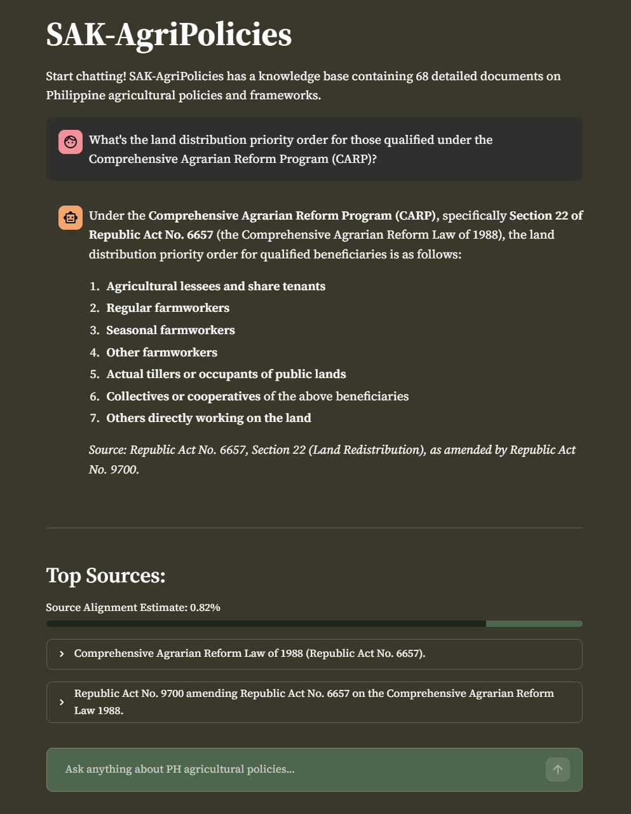

## Smart Agentic Knowledgebase for Philippine agricultural policies and frameworks

- A simple knowledge base of 68 FAOLEX documents (around 10-100 pages each) on agricultural policies and frameworks connected to a Langchain agent
- The agent is able to search the knowledgebase via lexical search and semantic search, as well as read whole documents if needed.



## Running:

1. Setup and ingest documents first:

```
uv venv
uv sync
uv run python -m data_download.download_pdfs
uv run python -m ingestion.ingest
```

2. Run FastAPI backend:

```
uv run uvicorn api.app:app --reload
```

3. Run Streamlit frontend:

```
uv run streamlit run frontend/app.py
```

Access at `http://localhost:8501/`.